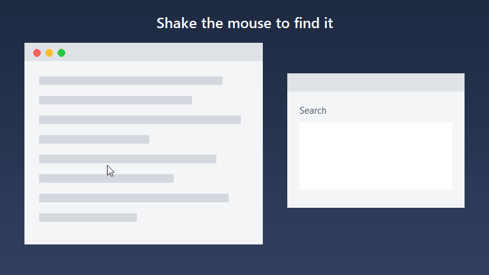
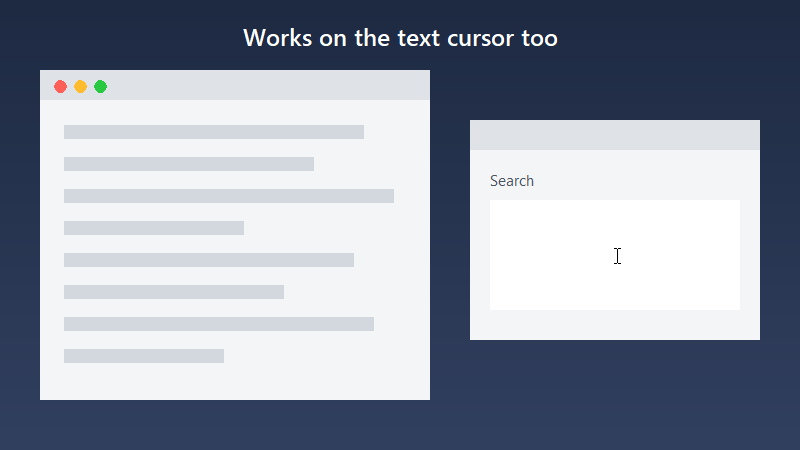

<p align="center">
  
</p>

<h1 align="center">BlazeCursor</h1>

<p align="center">
  <b>Shake your mouse to find your cursor — on Windows.</b><br>
  A tiny (~250 KB) Rust app that brings the macOS “shake mouse pointer to locate” feature to Windows.
</p>

<p align="center">
  
</p>

## Features

- **Shake to grow:** move the mouse quickly back and forth and the pointer grows to 4× its size, then shrinks back when you stop.
- **Smooth animation:** 32 sizes and a high-resolution timer, with easing so it settles in gently.
- **Uses your own cursors:** it enlarges your current arrow, text (I-beam) and link (hand) pointers, including custom cursor schemes.
- **Tiny and quiet:** a single standalone `.exe` with no installer and no runtime to install. It uses about 10 MB of RAM and almost no CPU.
- **Safe:** your normal cursors are always restored, even if the app was force-closed last time.

<p align="center">
  
</p>

## Download

Grab **`BlazeCursor.exe`** from the [latest release](../../releases/latest) and double-click it.

BlazeCursor sits in the system tray. Right-click its icon and choose **Quit BlazeCursor** to exit.

**Start with Windows:** press <kbd>Win</kbd>+<kbd>R</kbd>, type `shell:startup`, and put a shortcut to `BlazeCursor.exe` in that folder.

> Windows SmartScreen may warn about an unsigned app downloaded from the internet. Click *More info → Run anyway*, or build it yourself from source.

## Build from source

Requires [Rust](https://rustup.rs) with the MSVC toolchain (the Windows SDK provides `rc.exe` for the icon).

```bash
cargo build --release
```

The executable is written to `target/release/blazecursor.exe`.

## Tuning

All the knobs are constants at the top of [`src/main.rs`](src/main.rs):

| Constant | Default | Meaning |
| --- | --- | --- |
| `REVERSALS_TO_START` | `4` | Back-and-forth direction changes needed to trigger |
| `WINDOW` | `500 ms` | Time window those direction changes must happen in |
| `MAX_SCALE` | `4.0` | Maximum size relative to the normal cursor |
| `GROW_MS` / `SHRINK_MS` | `70` / `120` | Easing speed (higher = slower and gentler) |

## How it works

BlazeCursor checks the cursor position about every 10 ms and counts how often the horizontal direction flips with long, fast strokes. When it detects a shake, it swaps the system cursors for pre-loaded larger versions with `SetSystemCursor`. When you stop, it reloads your cursor scheme with `SPI_SETCURSORS`. It doesn't use hooks, drivers or a background service.

The demo GIFs/videos are recorded with [`assets/record_demo.py`](assets/record_demo.py) (real cursor, scripted shake), and the icon is generated by [`assets/make_icon.py`](assets/make_icon.py).

## License

[MIT](LICENSE): free for everyone to use, modify and share.
